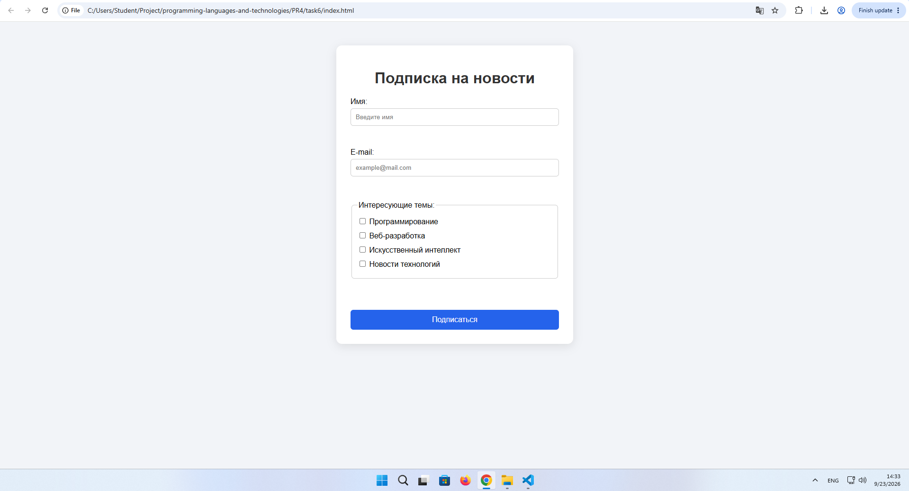
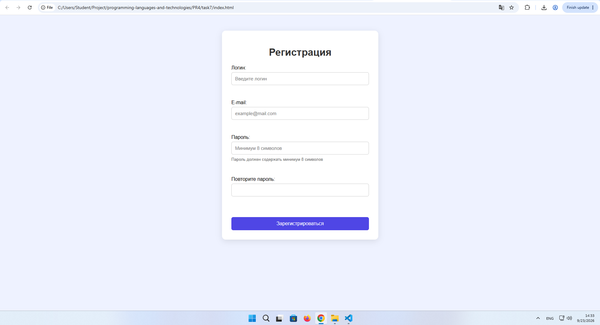
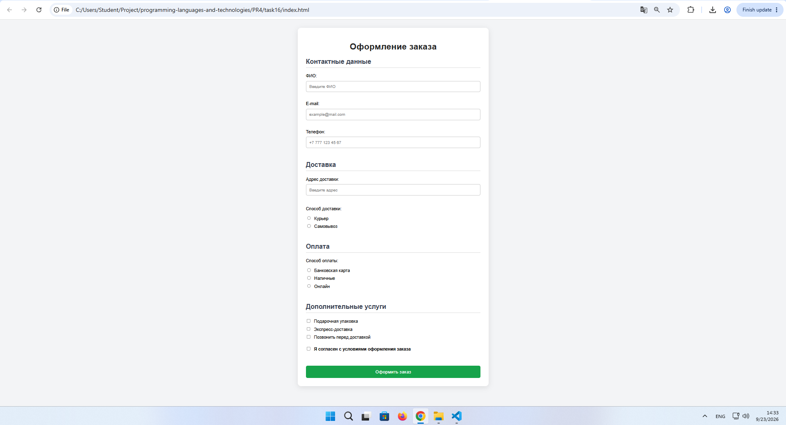

# programming-languages-and-technologies
Лабораторная работа №4
Формы и валидация на стороне клиента (HTML + JavaScript)
1. Цель работы

Создать HTML-формы и реализовать их проверку на стороне клиента с помощью JavaScript. Научиться работать с input, checkbox, radio, select, обрабатывать событие submit и выводить сообщения об ошибках без перезагрузки страницы.

2. Выполненные варианты

Вариант 6 — форма подписки.

Вариант 7 — форма регистрации аккаунта.

Вариант 16 — многоэлементная форма интернет-магазина.

3. Вариант №6 — Форма подписки
Условие

Форма содержит имя, e-mail и несколько интересующих тем. Необходимо проверить e-mail и выбор хотя бы одной темы.

Реализация

Использованы:

input type="text" — имя;

input type="email" — e-mail;

checkbox — интересующие темы;

button — отправка формы.

JavaScript проверяет:

Заполнено ли имя.

Заполнен ли e-mail.

Соответствует ли e-mail допустимому формату.

Выбрана ли хотя бы одна тема.

При успешной проверке на странице отображаются введённые данные.

Скриншот

Вставить скриншот формы №6 здесь

Тестирование
№	Сценарий	Ожидаемый результат
1	Все данные заполнены правильно	Успешная подписка
2	Имя не заполнено	Сообщение об ошибке
3	E-mail не заполнен	Сообщение об ошибке
4	Введён неправильный e-mail	Сообщение о некорректном e-mail
5	Не выбрана тема	Сообщение о выборе темы
4. Вариант №7 — Форма регистрации аккаунта
Условие

Форма содержит логин, e-mail, пароль и повтор пароля. Необходимо проверить длину пароля не менее 8 символов и совпадение паролей.

Реализация

Использованы:

input type="text" — логин;

input type="email" — e-mail;

input type="password" — пароль;

input type="password" — повтор пароля;

button — отправка формы.

JavaScript проверяет:

Заполнение логина.

Корректность e-mail.

Длину пароля — минимум 8 символов.

Совпадение паролей.

Дополнительно реализован индикатор состояния пароля при вводе.

Скриншот

Вставить скриншот формы №7 здесь

Тестирование
№	Сценарий	Ожидаемый результат
1	Все данные корректны	Успешная регистрация
2	Логин не заполнен	Сообщение об ошибке
3	Некорректный e-mail	Сообщение об ошибке
4	Пароль короче 8 символов	Сообщение об ошибке
5	Пароли не совпадают	Сообщение об ошибке
5. Вариант №16 — Многоэлементная форма интернет-магазина
Условие

Форма содержит контактные данные, доставку, оплату и дополнительные услуги. Необходимо реализовать несколько сообщений об ошибках рядом с соответствующими полями.

Реализация

Использованы:

текстовые поля для ФИО и адреса;

email для e-mail;

tel для телефона;

radio для способа доставки;

radio для способа оплаты;

checkbox для дополнительных услуг;

checkbox для согласия с условиями.

JavaScript проверяет:

Заполнение ФИО.

Корректность e-mail.

Заполнение телефона.

Заполнение адреса.

Выбор способа доставки.

Выбор способа оплаты.

Подтверждение согласия с условиями.

Ошибки выводятся рядом с соответствующими полями. После успешной проверки отображается информация о заказе без перезагрузки страницы.

Скриншот

Вставить скриншот формы №16 здесь

Тестирование
№	Сценарий	Ожидаемый результат
1	Все поля заполнены правильно	Заказ успешно оформлен
2	ФИО не заполнено	Сообщение об ошибке рядом с ФИО
3	Некорректный e-mail	Сообщение об ошибке рядом с e-mail
4	Не выбран способ доставки	Сообщение об ошибке
5	Не выбран способ оплаты	Сообщение об ошибке
6	Не подтверждены условия	Сообщение об ошибке
6. Контрольные вопросы
1. Что такое HTML-форма?

HTML-форма — элемент страницы для ввода и отправки данных пользователя.

2. Для чего используются input, select и button?

input используется для ввода данных, select — для выбора значения из списка, button — для выполнения действия.

3. Чем checkbox отличается от radio?

checkbox позволяет выбрать несколько вариантов, а radio — один вариант из группы.

4. Что такое клиентская валидация?

Проверка введённых данных непосредственно в браузере до их отправки на сервер.

5. Для чего используется событие submit?

Для обработки отправки формы и выполнения проверки данных.

6. Что делает event.preventDefault()?

Отменяет стандартную отправку формы и предотвращает перезагрузку страницы.

7. Как получить значение текстового поля?

С помощью свойства .value:

const name = document.getElementById("name").value;

8. Как проверить checkbox?

С помощью свойства .checked:

const agree = document.getElementById("agreement").checked;

9. Как получить выбранное значение select?

С помощью свойства .value:

const value = document.getElementById("course").value;

10. Почему клиентская валидация не заменяет серверную?

Клиентскую проверку можно обойти, поэтому сервер должен самостоятельно проверять полученные данные.

11. Как сделать сообщение об ошибке понятным?

Нужно указать конкретную проблему и действие, которое требуется выполнить. Например: Введите корректный e-mail.

12. Какие тестовые случаи следует проверить?

Корректное заполнение, пустые обязательные поля, неправильный формат данных, отсутствие обязательного выбора и граничные значения.

7. Вывод

В ходе лабораторной работы были разработаны три HTML-формы: форма подписки, форма регистрации аккаунта и многоэлементная форма интернет-магазина.

Для проверки данных использовался JavaScript. Были реализованы проверки обязательных полей, формата e-mail, длины и совпадения паролей, выбора radio и checkbox.

Отправка форм выполняется без перезагрузки страницы с использованием event.preventDefault(). При наличии ошибок пользователь получает соответствующее сообщение, а при успешной проверке отображается результат заполнения формы.

Цель лабораторной работы достигнута.